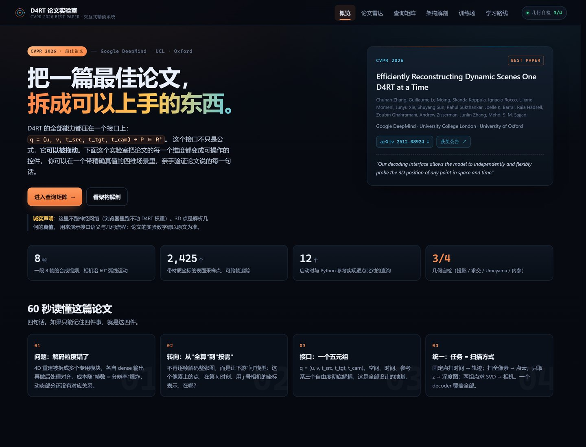
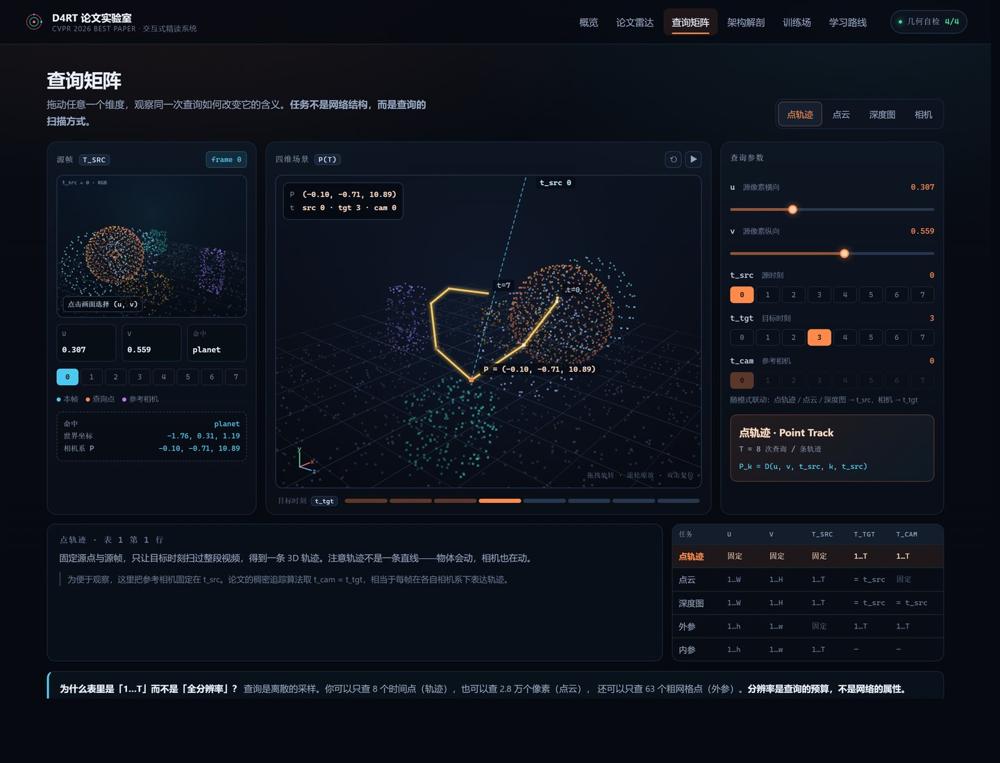

# D4RT 论文实验室

> 在 CVPR 2026 最佳论文 **D4RT** 的基础上，做一个把「读懂一篇顶会论文」变成可操作过程的交互式系统。



纯静态 · 零依赖 · 离线可用 · 无需构建

---

## 1. 这是什么

**D4RT 是 CVPR 2026 最佳论文**（*Efficiently Reconstructing Dynamic Scenes One D4RT at a Time*，Google DeepMind / UCL / Oxford，[arXiv:2512.08924](https://arxiv.org/abs/2512.08924)）。

它的全部能力压在一个接口上：

```
q = (u, v, t_src, t_tgt, t_cam)  →  P ∈ R³
```

这个项目不是复现它，而是**把这个接口做成可以拖动、可以犯错、可以自测的教学仪器**。学习者在一个带精确真值的四维场景里，亲手把五个维度都拨一遍，观察「换一种扫描方式 = 换一个任务」这句话到底意味着什么。

同时，它是一套**可扩展的论文精读模板**：换成任何一篇论文，只需要替换内容层的 JSON。

---

## 2. 为什么选这一篇（选题依据）

三条判断，都可以验证：

1. **这是一条正在收敛的主线。** 2025 与 2026 两届 CVPR 最佳论文恰好是同一个问题的两个阶段：
   - CVPR 2025：**VGGT** —— 把多视图几何从前馈回归问题解决掉；
   - CVPR 2026：**D4RT** —— 把「回归」换成「寻址」，把动态场景和相机参数统一进一个查询接口。
   读透这条链，等于拿到 2025–2026 年「前馈几何」方向的入场券。完整的雷达见 [`docs/paper-radar.md`](docs/paper-radar.md)。

2. **它的核心抽象天然可交互。** 多数论文的核心是损失函数或训练配方，只能看不能玩。D4RT 的核心是一个五元组查询——五个维度、一个输出，正好可以做成五个控件加一个三维视图。这是很少见的「论文即交互模型」。

3. **它教的是一个可迁移的思维。** 「按需查询」这个转向，与图形学里从光栅化到光线追踪、数据库里从物化视图到索引查询是同一类思想。学会它，比记住任何一个模块都有用。

---

## 3. 它解决的具体问题

读顶会论文有三道坎，这个系统对着三道坎各给一个解法：

| 坎 | 表现 | 这里的解法 |
|---|---|---|
| **概念密度高** | 一段话里五个新术语，读完不知道哪个是重点 | 「架构解剖」把论文拆成 7 步，每步给一句话本质 + 为什么 + 公式 + 伪代码 + **最常见的误解** |
| **公式与代码断层** | 公式看得懂，但不知道落到代码是什么样 | Python 参考实现 + 浏览器 1:1 复刻 + **双向一致性校验**（11 项 Python 自检 + 4 项浏览器自检） |
| **读完就忘** | 当时明白，一周后只剩标题 | 记忆卡（间隔重复）+ 概念自测 + 苏格拉底式复述 + 可导出的学习报告 |

---

## 4. 系统由什么组成

六个模块，对应六种学习动作：

| 模块 | 你在这里做什么 | 学到什么 |
|---|---|---|
| **概览** | 60 秒抓四件事 | 论文的问题、转向、接口、统一 |
| **论文雷达** | 看 2025–2026 顶会获奖图谱 | 这篇论文在谱系里的位置 |
| **查询矩阵** | 拖动 `u / v / t_src / t_tgt / t_cam`，点选像素，切换四种任务模式 | 接口的语义与几何 |
| **架构解剖** | 七步点开读 | 每个设计决策的动机与代价 |
| **训练场** | 翻卡、答题、写复述 | 从「读懂」到「记住」到「会用」 |
| **学习路线** | 五天计划 + 读论文的手艺 + 导出报告 | 可复用的方法论 |

查询矩阵的四种模式，正好是论文 Table 1 的五种任务（相机模式里含内外参）：

- **点轨迹**：固定 `(u,v)`，扫 `t_tgt` → 一条 3D 轨迹
- **点云**：扫全部像素，`t_cam` 固定 → 直接在参考系里解码
- **深度图**：同样的扫描，只取 `P.z` → 深度只是点云的副产品
- **相机**：粗网格两组解码 + Umeyama 求刚体变换 → **相机是「算」出来的，不是「猜」出来的**



---

## 5. 三个关键设计决策

**① 用解析真值场景，而不是在浏览器里跑网络。**
D4RT 权重不在浏览器里（也不该在）。所以场景是解析构造的：地面、三个方块、一个自转公转的行星、两个卫星，8 帧，相机沿 60° 弧线运动。每个表面点都有材质身份和运动方程，因此 `(u,v,t_src,t_tgt,t_cam) → P` 有**精确解**。

这带来一个好处：看到的不是「网络的近似」，而是接口的**定义**。界面里也写清了这一点——3D 点是真值，论文的实验数字以原文为准。

**② 把「最常见的误解」放在和公式同等的位置。**
新手读论文的失败，多半不是没看懂公式，而是看懂了却理解反了。所以每一步解剖都有独立的「常见误解」块，例如：

> 「dense 输出更准」是直觉陷阱。dense 只是把计算前置；如果下游只需要 500 个点，多算的 99% 是浪费，而且这些点之间并没有被显式约束成一致。

**③ 一致性必须可验证，而不是靠感觉。**
`lab/` 里的 Python 实现是唯一的几何真值来源；`web/js/scene.js` 是它的 1:1 复刻。`lab/export.py` 把场景与 12 个标准查询答案一起烘焙进前端，页面启动时逐点比对：

```
几何自检 4/4    查询接口与 Python 参考实现一致 · 最大偏差 5.4e-9
                外参恢复（Umeyama）· 35 组对应点
                内参恢复（中位数）· f/W = 1.177926
                Umeyama 还原已知刚体变换
```

任何一边改坏了，右上角的数字立刻变红。

---

## 6. 快速开始

**看界面（不需要 Python）**

```text
双击 web/index.html
```

**看界面（推荐，URL 更干净）**

```bash
python serve.py            # 自动打开 http://127.0.0.1:8765
```

**跑参考实现**

```bash
cd lab
python verify.py           # 11 项几何自检，应全部 PASS
python cli_query.py        # 命令行版的「查询矩阵」：五种任务依次演示
python export.py           # 改动场景后重新烘焙前端数据
```

依赖：Python 3.10+、numpy。前端零依赖。

**深链**：`?mode=cloud&tsrc=2#matrix` 可以直接分享某一次具体的查询。

---

## 7. 目录结构

```
d4rt-paper-lab/
├── web/                     # 纯静态前端，双击即开
│   ├── index.html
│   ├── css/app.css
│   └── js/
│       ├── scene-data.js    # 由 lab/export.py 生成（场景 + 相机 + 材质点）
│       ├── golden.js        # 由 lab/export.py 生成（标准答案，用于自检）
│       ├── scene.js         # 查询接口的浏览器实现（与 Python 1:1）
│       ├── render3d.js      # Canvas 2D 写的点云/线框渲染器（无 WebGL）
│       ├── data.js          # 全部教学内容（论文、解剖、题库、路线）
│       └── app.js           # 交互逻辑
├── lab/                     # 几何真值参考实现
│   ├── geometry.py          # 投影 / 求交 / Umeyama / 焦距
│   ├── scene.py             # 解析四维场景 + query()
│   ├── verify.py            # 10 项自检
│   ├── export.py            # 烘焙前端数据
│   ├── cli_query.py         # 命令行演示
│   ├── diagnose_pose.py     # 位姿恢复的数值诊断
│   └── preview.py           # 场景取景预览（调场景时用）
├── tools/                   # 开发期小工具（静态检查、编码检查、截图裁切）
├── docs/                    # 论文雷达、扩展指南
└── shots/                   # 截图
```

---

## 8. 数据来源与可信度

论文事实全部核对过官方来源，写在 `web/js/data.js` 的 `sources` 里：

- [CVPR 2025 最佳论文（官方）](https://cvpr.thecvf.com/Conferences/2025/BestPapersDemos)
- [CVPR 2026 最佳论文公告（官方，2026-06-09）](https://cvpr.thecvf.com/Conferences/2026/News/Best_Papers)
- [D4RT 论文（arXiv:2512.08924）](https://arxiv.org/abs/2512.08924)
- ICCV 2025 奖项为二手中文来源，已在界面中标注

方法细节（编码器结构、9×9 patch、独立解码、Umeyama、内参中位数、算法 1）均来自论文正文 §2 与 Table 1。

---

## 9. 作为「增量」的差异

| 形态 | 常见做法 | 这个项目 |
|---|---|---|
| 论文阅读器 | 摘要 + 翻译 + 目录 | 内容可交互，接口可操作 |
| 视频讲解 | 线性、不能提问 | 非线性、可反复试错 |
| 复现仓库 | 需要 GPU、环境、权重 | 零安装、离线、一秒打开 |
| 博客笔记 | 作者视角的结论 | 学习者视角的误解与自测 |

它不替代原论文，也不替代复现。它补的是中间那一段：**从「读完了」到「真的懂了」之间的空白**。

---

## 10. 路线图

- **接真实权重**：把 `lab/scene.py` 的解析 `query()` 换成 D4RT 推理结果（同一套接口），界面不变，即可对比「真值 vs 预测」。
- **换成小程序**：内容层是纯 JSON，几何层是纯 JS，`scene.js` 可直接迁到微信小程序（把 Canvas 2D 换成同构 API）。
- **多论文**：复制 `anatomy` / `modes` 两组内容，即可把同一套交互套到 VGGT、SAM 3D 等论文上（见 [`docs/how-to-extend.md`](docs/how-to-extend.md)）。
- **多人对照**：把学习报告汇总成班级/团队视图（当前报告已可导出 Markdown）。

---

## 11. 已知局限

- 3D 点是**解析真值**，不代表 D4RT 的实际精度；
- 场景是 8 帧、单一相机轨迹的合成数据，不覆盖遮挡、大形变、拓扑变化；
- 相机恢复的残差在 1e-2 度量级，来自采样点跨越远距离地面时的数值条件，不是算法缺陷（见 `lab/diagnose_pose.py`）；
- 界面以中文为主，术语保留英文原文。

---

## 12. 致谢

论文与图表版权归原作者所有。本项目只引用公开的论文信息与获奖公告，不包含论文图片或权重。
